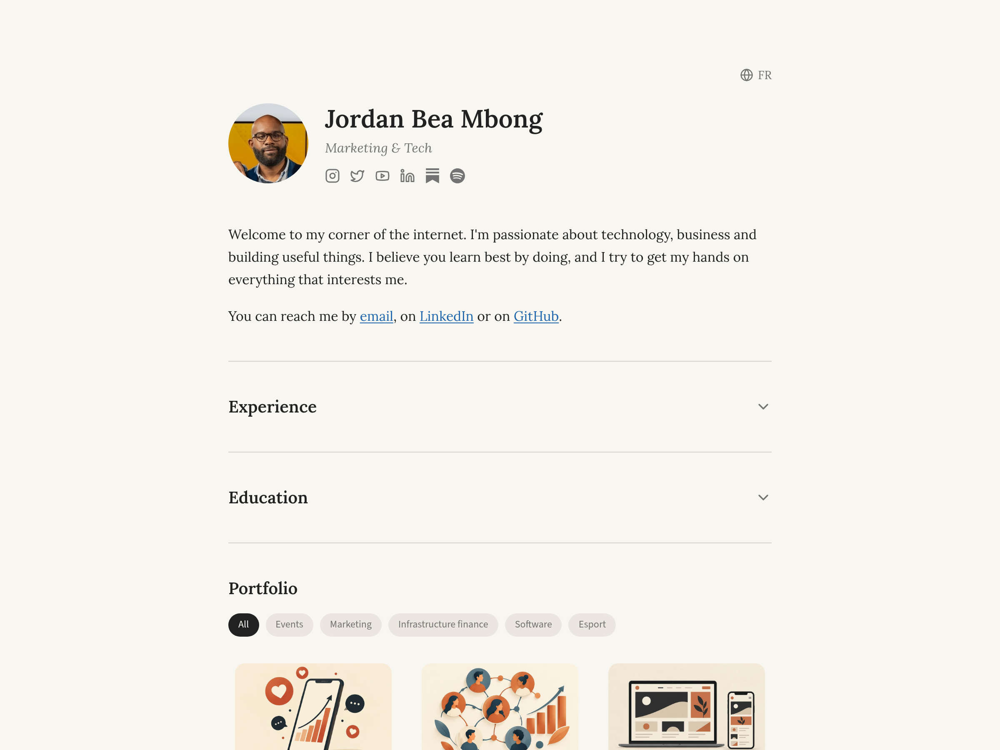

# Jordan Béa Mbong — Personal Website

Personal website of Jordan Béa Mbong — Marketing & Tech.

**Live site:** [jordanbeambong.com](https://jordanbeambong.com)



## What's inside

- **Portfolio**: filterable case studies across Marketing, Events, Software, Infrastructure Finance, and Esport, each with its own detail page.
- **Writing**: essays and articles on marketing, tech, and business.
- **Experience & Education**: collapsible career and academic timelines.
- **Bilingual (EN / FR)**: instant language toggle across the entire site.

## Tech stack

- React, TypeScript, Vite, Tailwind CSS
- 100% static site — no database or CMS; all content lives in `src/data/` (`translations.ts`, `articles.ts`, `socials.ts`)

## Run locally

```sh
git clone <this-repository-url>
npm install
npm run dev
```
